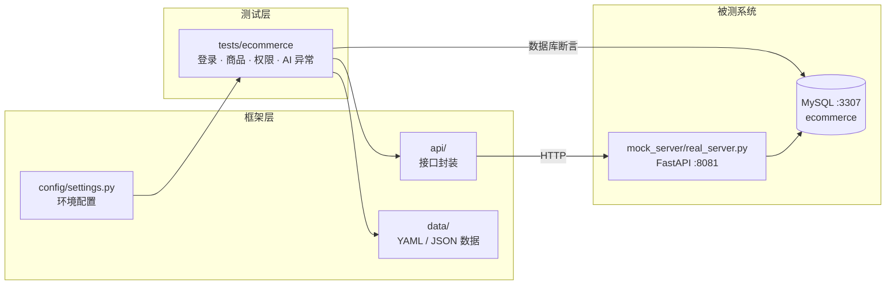
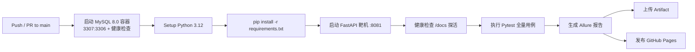

<div align="center">

# 电商业务接口自动化测试框架

**Python · Pytest · Requests · MySQL · Allure · GitHub Actions**

一套面向真实业务场景的接口自动化测试框架：自建 `FastAPI + MySQL` 高仿真电商靶机，
覆盖多角色鉴权、JWT 接口关联、商品发布/删除业务流、水平与垂直越权防护，
并直连数据库做**落库断言**，而不是"看到 200 就算通过"。

[](https://github.com/chenjt-bit/api-auto-demo/actions/workflows/test.yml)


[在线测试报告](https://chenjt-bit.github.io/api-auto-demo/) ·
[测试用例设计](<docs/电商业接口测试用例.xlsx>) ·
[问题反馈](https://github.com/chenjt-bit/api-auto-demo/issues)

</div>

---

## 目录

- [项目简介](#项目简介)
- [核心特性](#核心特性)
- [技术栈](#技术栈)
- [架构设计](#架构设计)
- [测试覆盖](#测试覆盖)
- [快速开始](#快速开始)
- [执行测试](#执行测试)
- [测试报告](#测试报告)
- [持续集成](#持续集成)
- [性能压测](#性能压测)
- [常见问题](#常见问题)
- [已知限制与规划](#已知限制与规划)

---

## 项目简介

绝大多数接口自动化练手项目都停在"请求一个假接口，断言 200"。
本项目反过来：**先自己造一个真实后端，再对它做自动化测试**。

靶机 `mock_server/real_server.py` 是一个基于 FastAPI + MySQL 的电商服务，
包含注册、登录、JWT 鉴权、商品发布、商品查询、商品删除、管理员查询用户等完整业务链路。
测试框架则围绕这套真实业务，验证**状态码、响应体、数据库落库结果、越权防护**四个层面。

这样设计的好处是：测试结论可信。商品"发布成功"不仅是接口返回 200，
而是能在 MySQL 的 `items` 表里查到这条记录、字段值完全一致、且 `owner_id` 归属正确。

## 核心特性

| 能力 | 说明 |
| --- | --- |
| **分层架构** | 配置层 / 接口封装层 / 数据层 / 用例层 / 靶机层，职责单一，互不污染 |
| **业务分域** | 按登录、商品、权限拆分测试模块，用 `pytest.mark` 打标，可按模块精准回归 |
| **动态数据工厂** | 毫秒时间戳 + UUID 生成唯一账号与商品名，彻底解决"重复执行报错"和测试数据污染 |
| **接口 + 数据库双重断言** | 直连 MySQL 校验数据是否真正持久化，拒绝表面断言 |
| **越权防护测试** | 水平越权（用户 B 删除用户 A 的商品 → 403）+ 垂直越权（普通用户访问管理接口 → 403） |
| **数据驱动** | YAML 管理边界数据（正常价 / 0 元 / 负价 / 空名 / 超长名 / emoji），一份用例覆盖多组场景 |
| **AI 辅助造数** | `ai_client.py` 调用大模型生成异常用例数据，产出落盘为 JSON 由用例消费 |
| **可视化报告** | Allure 中文标题 + 业务步骤 + 严重级别，失败可直接定位到具体步骤 |
| **云端 CI/CD** | GitHub Actions 自动拉起 MySQL 容器、启动靶机、执行全量用例、发布在线报告 |

## 技术栈

| 分类 | 选型 |
| --- | --- |
| 语言 | Python 3.12+ |
| 测试框架 | Pytest 9（Fixture、参数化、Marker） |
| 请求库 | Requests（Session 复用 + 连接/读取超时） |
| 数据驱动 | PyYAML / JSON |
| 数据库 | MySQL 8.0 + PyMySQL |
| 靶机服务 | FastAPI + Uvicorn + Pydantic + python-jose(JWT) + DBUtils(连接池) |
| 测试报告 | Allure 2.x |
| 性能压测 | Locust |
| 持续集成 | GitHub Actions（MySQL Service Container + GitHub Pages） |

## 架构设计



**分层原则**：用例层只写"业务动作 + 断言"，不出现裸 URL 和 SQL 拼接；
接口路径、请求方式、超时策略全部收敛在 `api/` 层；环境地址与账号收敛在 `config/`。

```text
api-auto-demo/
├── .github/workflows/
│   └── test.yml                 # CI 流水线：MySQL 容器 + 靶机 + 用例 + Allure 发布
├── api/                         # 接口封装层（只关心"怎么发请求"）
│   ├── ecommerce_login_api.py
│   ├── ecommerce_item_api.py
│   └── posts_api.py             # 文章模块封装示例（当前未纳入用例集）
├── config/
│   └── settings.py              # 环境地址、超时、账号池
├── data/                        # 数据驱动层（只关心"用什么数据测"）
│   ├── ecommerce_items.yaml     # 商品边界值数据
│   ├── ai_generated_items.json  # AI 生成的异常数据
│   └── posts_data.yaml
├── docs/
│   └── 电商业接口测试用例.xlsx   # 测试用例设计文档（ID / 优先级 / 预期 / 实际）
├── mock_server/
│   └── real_server.py           # 被测系统：FastAPI + MySQL 电商靶机
├── tests/
│   ├── conftest.py              # 全局 Fixture：HTTP Session、数据库游标
│   └── ecommerce/
│       ├── conftest.py          # 业务 Fixture：用户工厂、Token 工厂、商品工厂
│       ├── test_login.py        # 登录模块
│       ├── test_items.py        # 商品模块
│       ├── test_ai_items.py     # AI 数据驱动的异常场景
│       └── test_permission.py   # 权限模块
├── ai_client.py                 # AI 用例数据生成脚本（独立工具，不参与用例执行）
├── locustfile.py                # Locust 性能压测脚本
├── conftest.py                  # 根 Fixture：--env 环境切换
├── pytest.ini                   # Pytest 配置：路径、Marker、Allure
├── requirements.txt
└── README.md
```

## 测试覆盖

共 **24 条**自动化用例，全部可重复执行。

| 模块 | 文件 | 用例数 | 覆盖场景 |
| --- | --- | ---: | --- |
| 登录 | `test_login.py` | 5 | 正确账号登录并校验 Token、密码错误 401、用户不存在 401、空参数 422、用户名带空格 |
| 商品 | `test_items.py` | 11 | 发布商品 + 数据库落库断言、删除自己的商品 + 数据库验证、价格边界参数化（7 组）、端到端全链路（发布→查询→落库）、水平越权删除 403 |
| 权限 | `test_permission.py` | 3 | 管理员登录、普通用户访问 `/admin/users` 返回 403、管理员访问返回 200 |
| AI 异常 | `test_ai_items.py` | 5 | 大模型生成超长字符、空串、SQL 注入串、emoji、负价格等异常数据的回归验证 |

**关键业务链路**：

```text
注册（唯一账号） → 登录（JWT Token） → 发布商品 → 查询商品列表 → 数据库校验 → 越权删除被拒 → 本人删除成功
```

## 快速开始

### 前置要求

| 依赖 | 版本 | 说明 |
| --- | --- | --- |
| Python | 3.12+ | 用例中使用了 3.12 的 f-string 嵌套引号语法 |
| MySQL | 8.0 | 靶机默认连接 `127.0.0.1:3307`，账号 `root / 123456` |
| Git | 任意 | 克隆仓库 |

> 数据库、数据表与管理员账号由靶机在**启动时自动创建**，无需手工建库建表。

### 1. 启动 MySQL

已有 MySQL 的，确认监听 `3307` 端口即可。没有的话用 Docker 一条命令拉起：

```bash
docker run -d --name ecommerce-mysql \
  -p 3307:3306 \
  -e MYSQL_ROOT_PASSWORD=123456 \
  mysql:8.0
```

### 2. 克隆并安装依赖

```bash
git clone https://github.com/chenjt-bit/api-auto-demo.git
cd api-auto-demo

python -m venv .venv

# Windows (PowerShell)
.venv\Scripts\Activate.ps1
# macOS / Linux
source .venv/bin/activate

pip install -r requirements.txt
```

### 3. 配置环境变量

在项目根目录创建 `.env.dev`（该文件已被 `.gitignore` 忽略，不会提交）：

```ini
BASE_URL=http://127.0.0.1:8081
DB_PASSWORD=123456
```

- `--env dev`（默认）读取 `.env.dev`；`pytest --env test` 则读取 `.env.test`
- 云端的 `.env.*` 文件不存在，因此 CI 直接通过环境变量注入，二者互不冲突

> 使用 AI 造数脚本时，另需在 `.env` 中配置 `LLM_API_KEY`（仅本机使用，请勿提交）。

### 4. 启动靶机服务

```bash
cd mock_server
uvicorn real_server:app --port 8081 --reload
```

看到 `✅ 数据库初始化完成` 与 `Uvicorn running on http://127.0.0.1:8081` 即启动成功。
接口文档（Swagger）：<http://127.0.0.1:8081/docs>

> 请保持该终端开启，然后**新开一个终端**执行测试。

### 5. 执行测试

```bash
# 回到项目根目录
cd ..

pytest
```

## 执行测试

> 命令需在**项目根目录**执行（数据文件按工作目录相对路径加载）。

| 场景 | 命令 |
| --- | --- |
| 全量执行（默认生成 Allure 原始数据） | `pytest` |
| 只跑电商业务 | `pytest tests/ecommerce/ -v` |
| 按模块筛选用例 | `pytest -m ecommerce_items` |
| 按模块筛选用例（登录） | `pytest -m ecommerce_login` |
| 单条用例 | `pytest tests/ecommerce/test_login.py::test_user_login -v` |
| 指定环境 | `pytest --env test` |
| 只看用例清单，不执行 | `pytest --collect-only -q` |

**可用 Marker**：

| Marker | 含义 |
| --- | --- |
| `ecommerce` | 电商靶机整体业务 |
| `ecommerce_login` | 登录模块 |
| `ecommerce_items` | 商品模块 |

## 测试报告

### 本地查看

`pytest.ini` 已默认把结果写入 `./allure-results`，执行完测试后：

```bash
# 直接起本地服务预览（推荐）
allure serve ./allure-results

# 或先生成静态站点，再打开 allure-report/index.html
allure generate ./allure-results -o ./allure-report --clean
```

未安装 Allure CLI 时：

```bash
npm install -g allure-commandline --save-dev
# 或从 https://github.com/allure-framework/allure2/releases 下载后加入 PATH
```

### 在线报告

`main` 分支每次流水线执行后，报告会自动发布到 GitHub Pages：

**<https://chenjt-bit.github.io/api-auto-demo/>**

报告中包含：用例中文标题、业务步骤、严重级别、执行耗时、失败堆栈，
以及每条用例的所属模块分类。

## 持续集成

流水线定义：`.github/workflows/test.yml`，在 `push` / `pull_request` 到 `main` 时触发。



设计要点：

- **真实数据库**：通过 GitHub Actions `services` 拉起 MySQL 8.0 容器，与本地环境保持一致，不降级为 SQLite
- **服务探活**：靶机启动后循环探测 `/docs`，确保服务真正就绪再跑用例，避免"连接拒绝"的假失败
- **失败可追溯**：用例失败时强制打印后端 `uvicorn.log`，并生成报告（`if: always()`），红叉不会丢失现场
- **环境隔离**：CI 通过 `env` 注入配置，不依赖仓库中的 `.env` 文件，密码类信息不落库

查看入口：

| 内容 | 位置 |
| --- | --- |
| 执行历史与日志 | 仓库 **Actions** 页签 |
| 报告压缩包 | 单次运行的 **Artifacts → allure-test-report** |
| 在线报告 | **<https://chenjt-bit.github.io/api-auto-demo/>** |

## 性能压测

`locustfile.py` 模拟真实用户行为：每个虚拟用户启动时注册并登录获取专属 Token，
随后按 3:1 的比例执行"发布商品"与"查询商品"。

```bash
# 确保靶机已启动
locust -f locustfile.py --host http://127.0.0.1:8081

# 无界面模式：100 并发，持续 60 秒
locust -f locustfile.py --host http://127.0.0.1:8081 \
  --headless -u 100 -r 10 -t 60s
```

打开 <http://127.0.0.1:8089> 查看实时 RPS、响应时间分布与失败率。
靶机侧通过 `DBUtils` 连接池承载并发，避免高并发下连接被打满。

## 常见问题

<details>
<summary><b>1. 启动靶机报错：数据库初始化失败</b></summary>

```
❌ 数据库初始化失败: (2003, "Can't connect to MySQL server on '127.0.0.1'")
```

MySQL 未启动或端口不对。确认容器/服务监听 `3307`：

```bash
# Docker
docker ps | grep mysql
# Windows
netstat -ano | findstr 3307
```
</details>

<details>
<summary><b>2. 用例报 ConnectionError / 全部 500</b></summary>

靶机没起或端口被占用。先访问 <http://127.0.0.1:8081/docs> 确认服务存活。
若端口被占用，可换端口启动，并同步修改 `.env.dev` 中的 `BASE_URL`。
</details>

<details>
<summary><b>3. Windows 终端执行 AI 用例报 UnicodeEncodeError</b></summary>

`test_ai_items.py` 会打印含 emoji 的对比信息，而 Windows 控制台默认使用 GBK 编码，无法输出 emoji：

```
UnicodeEncodeError: 'gbk' codec can't encode character '\U0001f449'
```

临时规避（不影响用例逻辑，CI 的 Ubuntu 环境为 UTF-8，不存在此问题）：

```powershell
$env:PYTHONIOENCODING = "utf-8"
pytest
```
</details>

<details>
<summary><b>4. 报 FileNotFoundError: 'data/ecommerce_items.yaml'</b></summary>

当前数据文件按**工作目录**相对定位，请在项目根目录执行 `pytest`。
若使用 IDE 的"单文件运行"，请把 Working directory 设置为项目根目录
（该问题已列入规划，后续将改为基于 `__file__` 的绝对路径）。
</details>

<details>
<summary><b>5. 报告中文乱码</b></summary>

确认终端与文件编码均为 UTF-8。PowerShell 可执行：

```powershell
[Console]::OutputEncoding = [System.Text.Encoding]::UTF8
```
</details>

## 已知限制与规划

本项目为个人进阶实战项目，仍在持续迭代。以下是当前**明确的不足**，也是下一步的改进方向：

| 类别 | 当前状态 | 规划 |
| --- | --- | --- |
| 配置治理 | 数据库连接信息在靶机与测试夹具中各有一份 | 收敛到 `config/settings.py` 单一入口 |
| 数据清理 | 用例产生的商品数据不自动清理，长期执行会累积 | 增加按 run_id 清理的 Fixture，或每用例事务回滚 |
| 数据路径 | 依赖工作目录相对路径 | 改为基于 `__file__` 的绝对路径 |
| 契约校验 | 已安装 `jsonschema`，尚未接入断言 | 为响应体补充 JSON Schema 校验 |
| 鉴权用例 | 覆盖了 403 越权，缺少 401 无 Token / 过期 Token 场景 | 补充 Token 失效链路 |
| 代码质量 | 无 lint / 类型检查门禁 | 接入 ruff + mypy + pre-commit |
| 依赖管理 | `requirements.txt` 为全量冻结清单 | 拆分运行/开发依赖，使用 constraints 锁版本 |
| 用例追溯 | 用例与 `docs/` 设计文档未建立 ID 关联 | 用 `@allure.id` 打通需求—用例—结果 |

> 欢迎通过 [Issues](https://github.com/chenjt-bit/api-auto-demo/issues) 交流指正。

---

## 免责声明

靶机服务、账号密码与测试数据仅用于本地学习与演示，**不可直接用于生产环境**。
仓库中不包含任何真实业务数据、生产地址或密钥，请勿将 `.env` 等本地配置文件提交到远端。

<div align="center">

如果这个项目对你有帮助，欢迎点个 ⭐ Star

</div>
